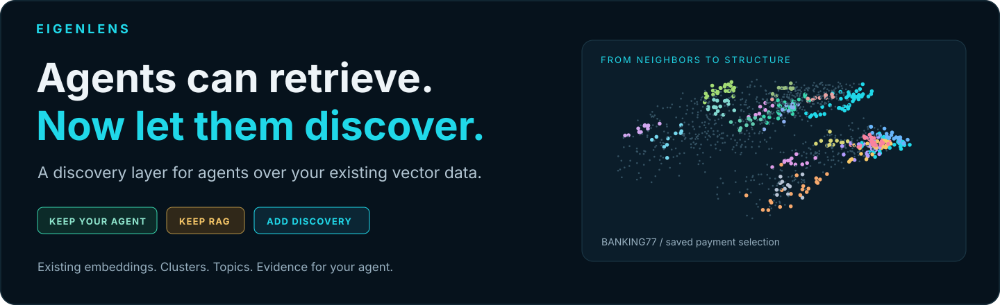
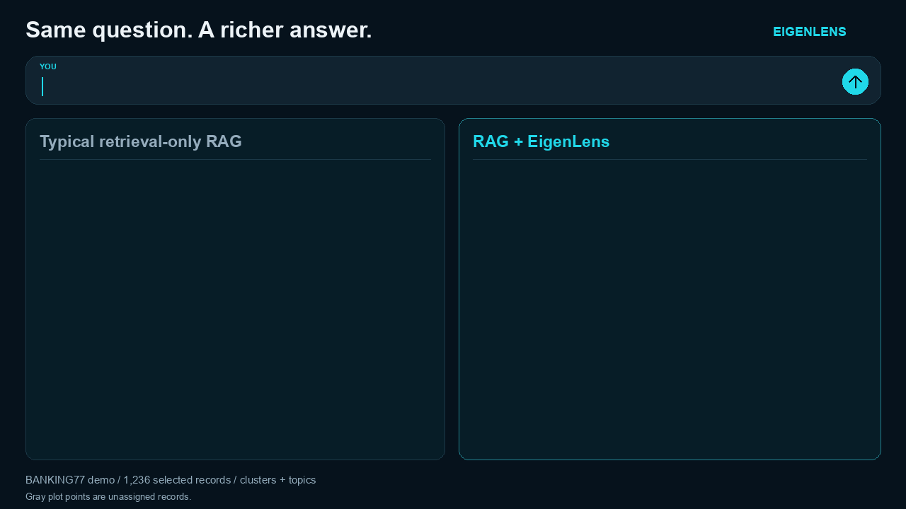
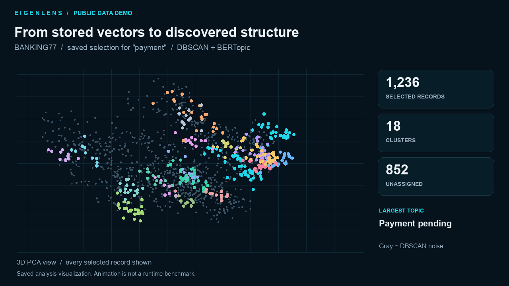
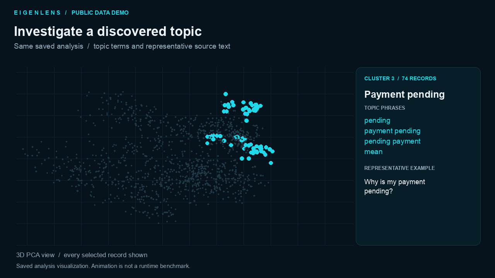
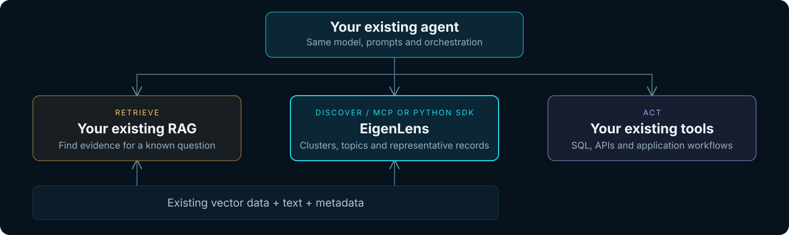
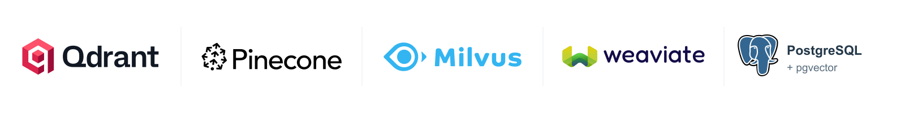

# EigenLens



**A discovery layer for agents over the vector data you already have.**

Keep your agent. Keep RAG. Add discovery. EigenLens turns existing embeddings into **clusters, topics and representative records** through Python or MCP. Your agent can explore what is in a collection, then investigate the groups it finds.

[Comparison](#what-does-discovery-add) · [Demo](#see-discovery-in-action) · [Installation](#installation) · [Python](#use-your-existing-python-database-client) · [MCP](#connect-mcp-to-a-chat-agent) · [OpenAI Agents SDK](docs/openai-agents.md) · [Docker Hub](https://hub.docker.com/r/eigenlake/eigenlens)

## What does discovery add?

**Same question. Same saved selection of 1,236 records.**



[Static comparison](docs/assets/rag-vs-eigenlens.png)

<details>
<summary><strong>Read the comparison</strong></summary>

> “What payment issues appear in these banking questions?”

| Typical retrieval-only RAG | RAG + EigenLens |
| --- | --- |
| “Retrieved examples mention pending payments, declined payments and unrecognized payments in the app.” | “Across **1,236 selected records**, DBSCAN found **18 clusters** and left **852 records unassigned**. Topics include pending card payments, unrecognized card payments and declined card payments.” |
| Inspect relevant passages and their sources. | Inspect a cluster plot, group sizes, BERTopic phrases and representative source records. |
| Follow up by retrieving more evidence. | Follow up with “Show examples from the largest cluster” or “Which records remain unassigned?” |

</details>

## See discovery in action



**Real public data:** a saved selection of **1,236** payment-related BANKING77 records, analyzed with DBSCAN and BERTopic. Colors show **18 clusters**; gray shows **852 unassigned records**. Every selected record is displayed. PCA provides the visualization coordinates.

This is an animation of saved results, not a recording of execution speed or an analysis of the full corpus. [Static preview](docs/assets/banking77-clusters.png) · [Run BANKING77 yourself](#try-the-banking77-demo)

<details>
<summary><strong>Explore topics and representative examples</strong></summary>



The same analysis provides topic phrases and source examples for each group. These labels come from BERTopic; no language model was used to name this demo's clusters.

</details>

## From retrieval to discovery

RAG helps an agent find evidence for a question. EigenLens helps it examine the structure within that evidence or a complete collection.

| Your agent asks | EigenLens returns |
| --- | --- |
| “What groups exist in these records?” | DBSCAN clusters, sizes and assignments |
| “What is each group about?” | BERTopic keywords and phrases |
| “Show the evidence behind this topic.” | Representative record IDs and source text |
| “Which records do not belong to a group?” | Unassigned records, marked `-1` |
| “What is my analysis doing?” | Job status, detailed stages and available counters |



**Use stored embeddings.** Analysis does not re-embed your records. DBSCAN discovers groups; BERTopic uses those assignments to extract topic terms through its manual workflow. Results include coordinates that your agent or application can plot.

**Run work in the background.** The MCP server queues analysis in isolated processes, supports cancellation, saves results and reuses identical completed analyses. Default concurrency is **1 worker**, configurable up to 16. More workers run more jobs concurrently; they do not distribute a single analysis.

## Installation

### Python and local MCP

Requires **Python 3.11+** and access to the source repository:

```bash
pip install 'eigenlens[server,qdrant] @ git+https://github.com/EigenLake-Org/eigenlens.git@main'
```

This installs the `eigenlens` command, DBSCAN, BERTopic and the Qdrant adapter. Other database extras are `pinecone`, `milvus`, `weaviate` and `pgvector`; `[server,databases]` installs all five. This is a pip install from Git, not a PyPI release.

### Public Docker image

The MCP server and analysis worker are available together for Linux AMD64 and ARM64:

```bash
docker pull eigenlake/eigenlens:eigenlens-0.1.0
```

**No repository clone or registry login is needed to pull the image.** Follow the [Docker quickstart](docs/worker.md#prebuilt-image) to set the private runtime configuration, start the worker and connect to `http://127.0.0.1:8020/mcp` with its bearer token.

## Connect your vector database



Read existing vectors, text and metadata through **Qdrant, Pinecone, Milvus, Weaviate or PostgreSQL/pgvector** adapters. Source database access is read-only. `get_capabilities` reports which drivers are installed.

| Use case | Where connection settings go |
| --- | --- |
| Existing Python application | Pass your initialized Qdrant or Weaviate client to `el.from_client` |
| Agent using MCP | Call `connect_database` with database type, URL, credentials and options; retain its returned `connection_id` |
| Server-managed local default | Set `EIGENLENS_DATABASE_TYPE`, `EIGENLENS_DATABASE_URL` and optional credentials/options in the server environment |

MCP connections are encrypted in `<EIGENLENS_DATA>/connections.sqlite` and scoped to the authenticated caller. Retain `EIGENLENS_CONNECTION_KEY` separately across restarts. The database URL must be reachable **from the MCP server**. See [connection settings, storage and backend limitations](docs/databases.md).

For a focused question, retrieve a bounded search selection using the collection's embedding model. To analyze a whole collection, omit the query: the adapter reads every page or fails at configured limits. Analysis processes **all returned records**. A top-k search does not establish that every semantic match was retrieved.

## Use your existing Python database client

```python
import eigenlens as el
from qdrant_client import QdrantClient

client = QdrantClient(url="http://localhost:6333")
try:
    data = el.from_client(
        client,
        collection="your_collection",
        text_field="text",
    ).materialize()

finally:
    client.close()

results = el.analyze(data, [
    {"id": "groups", "type": "cluster", "algorithm": "dbscan_search"},
    {"id": "themes", "type": "topics", "algorithm": "bertopic",
     "clusters_from": "groups", "parameters": {"ngram_max": 2}},
])
print(results["groups"].summary())
print(results["themes"].summary())
```

Use your collection name and text field. `from_client` accepts **QdrantClient or WeaviateClient v4**; reads begin at `materialize()`. Python analysis runs in your application's process. [Client options, query vectors and MCP handoff](docs/databases.md#existing-python-sdk-clients)

## Connect MCP to a chat agent

Connect your MCP host to the installed `eigenlens` executable over stdio, or to a running worker through Streamable HTTP. Your agent discovers the tools; analysis runs on the EigenLens worker.

For local Codex after pip installation:

```bash
codex mcp add eigenlens \
  --env "EIGENLENS_DATA=$HOME/.local/share/eigenlens" \
  -- eigenlens
```

Start a new session with the server enabled. Connect a database, list its collections and retain the connection ID and collection name in the conversation. Other MCP hosts use the same executable or HTTP endpoint. [Connection options and exact tool calls](docs/mcp.md)

### Ask in chat

> Connect to my configured vector database and list its collections.

> Search my selected collection for ATM-related records. Report the selection count and search limit. Cluster every retrieved record with DBSCAN, extract BERTopic phrases, and show cluster sizes, unassigned records and examples. Wait for completion and report any failure.

> Plot the clusters in 3D, then show five examples from the largest cluster.

Plotting requires chart or file-rendering tools in the agent application. EigenLens returns assignments and coordinates; the BANKING77 example also writes an interactive HTML plot.

### The clustering call

After `retrieve_records` or `register_records` returns a dataset ID, the agent calls:

```json
{
  "name": "run_analysis",
  "arguments": {
    "dataset_id": "ds_example",
    "operations": [
      {"id": "groups", "type": "cluster", "algorithm": "dbscan_search"},
      {"id": "themes", "type": "topics", "algorithm": "bertopic",
       "clusters_from": "groups", "parameters": {"ngram_max": 2}}
    ]
  }
}
```

Replace `ds_example` with the returned ID. Poll `get_job(job_id)`, then use its result IDs to read summaries, examples and all result pages. Keep `status` for the outcome and display `info.message` for the current stage. Stage counters are not an overall completion percentage.

### All MCP tools

These are agent tool calls, not terminal commands. [Arguments and complete examples](docs/mcp.md) · [Database tool examples](docs/databases.md)

| Tools | Purpose |
| --- | --- |
| `get_capabilities` | Discover algorithms, parameters, drivers and limits |
| `connect_database`, `list_connections`, `disconnect_database` | Manage caller-owned database connections |
| `list_collections`, `retrieve_records` | Discover collections and register a retrieval snapshot |
| `register_records` | Register supplied records or a staged JSONL artifact |
| `run_analysis`, `get_job`, `cancel_job` | Submit, inspect and cancel jobs |
| `get_summary`, `get_examples`, `get_result_page` | Read counts, evidence and paginated results |

## Use with the OpenAI Agents SDK

Attach EigenLens through `MCPServerStreamableHttp` and your existing agent's `mcp_servers`. Existing tools stay on that agent. **No EigenLens installation or clone is needed in the agent application** when it connects to an HTTP worker.

```bash
pip install 'openai-agents==0.22.2'
export EIGENLENS_MCP_URL=http://127.0.0.1:8020/mcp
# Supply OPENAI_API_KEY and EIGENLENS_MCP_TOKEN privately.
```

**[Open the complete Agents SDK guide →](docs/openai-agents.md)** for runnable Python, database connections, adding MCP to an existing agent and detailed job progress.

## Try the BANKING77 demo

[BANKING77](https://huggingface.co/datasets/mteb/banking77) contains **13,069 banking questions across 77 intents**. Setup combines the train and test splits, creates MiniLM embeddings once and indexes them in Qdrant. No OpenAI API key is required.

The example scripts require source repository access. From a checkout, install and run:

```bash
pip install -c requirements-tested.txt '.[server,banking]'
docker compose --profile qdrant up -d --wait qdrant
python -m examples.banking77 setup
python -m examples.banking77 analyze
```

Setup records dataset/model revisions and reuses its local embedding cache. Analysis processes the full cached corpus and saves assignments, topic terms and an interactive 3D plot in `demo-output/banking77/`. The GIF above uses a separate payment-related selection; its cluster counts will differ from a full-corpus analysis.

### Use the banking dataset in chat

After setup, register the dedicated demo server from the repository directory:

```bash
codex mcp add eigenlens-banking \
  --env "EIGENLENS_DATA=$PWD/.eigenlens/banking77" \
  -- eigenlens --config "$PWD/config/banking77.json"
```

Start a new session and ask:

> Use eigenlens-banking to register banking77.jsonl as a complete selection. Cluster all records with DBSCAN search, then model their topics with BERTopic. Wait for completion and show cluster sizes, unassigned records, topic terms and examples.

The prepared artifact is already staged. The demo configuration accepts the full corpus; the generic local server defaults to a 10,000-record limit. To exercise MCP without a language model, run `python examples/mcp_client.py` after installation; it analyzes 62 synthetic records.

## Scope and limits

EigenLens currently runs bounded, in-memory PCA/DBSCAN analyses and BERTopic topic extraction. It does not provide distributed million-row clustering or time-series change detection. Unassigned records are **not calibrated anomaly scores**. Row, memory and time limits apply; oversized selections fail without silent sampling. See [performance, caching and resource limits](docs/performance.md) and [worker configuration](docs/worker.md).

## Documentation

| Guide | Contents |
| --- | --- |
| [MCP](docs/mcp.md) | All 13 tools, exact calls, uploads and job stages |
| [Database connections](docs/databases.md) | Credentials, adapters and existing Python clients |
| [OpenAI Agents SDK](docs/openai-agents.md) | Connect EigenLens to an existing agent |
| [Docker worker](docs/worker.md) | Public image, persistence and worker count |
| [Contracts](docs/contracts.md) | Records, operations and result formats |
| [Architecture](docs/architecture.md) | How retrieval, jobs and analysis fit together |
| [Publishing](docs/publishing.md) | Versioned container releases |
| [Demo media](docs/assets/README.md) | Add GIFs, regenerate visuals and inspect provenance |

For development: `pip install -e '.[server,banking,databases,test]'` then `pytest -q`.
