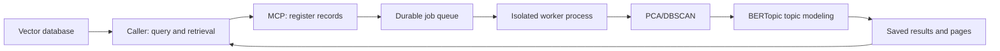

# Architecture

The caller owns database connections, query embeddings, and record selection. The core accepts bounded records containing existing embeddings and optional text. A registered dataset is an immutable caller-owned snapshot. No database access or embedding generation runs in the core.

`Service` validates plans before queueing. One `Supervisor` holds an exclusive filesystem lock on its data directory and starts up to `max_jobs` spawned processes. Each process materializes records once, runs operations in dependency order, and saves portable JSON results. PCA/DBSCAN and topic extraction execute in these job processes, inside the worker container when deployed with Compose. The SDK runs the same algorithms synchronously in the calling process.

The HTTP or stdio MCP process remains available during analysis. HTTP uploads stream into a principal-specific staging directory; registration validates and copies them into durable dataset artifacts. Application code handles polling and cleanup of staged uploads. Results expose record IDs, assignments, topic terms, examples, scope, effective parameters and provenance. DBSCAN pages also contain 3D coordinates; the caller builds the plot.

SQLite holds job state and artifact ownership. Files hold dataset, materialization and result content. Successful jobs remain readable after restart. Interrupted jobs are marked failed; cancellation terminates the selected process. Changing worker count requires restart. Automatic retention is not implemented.

The package requires NumPy, SciPy, scikit-learn, Pydantic and threadpoolctl. BERTopic is the topic modeling dependency and includes its own supporting libraries. MCP and Uvicorn are optional server dependencies. Analysis uses caller-supplied embeddings and DBSCAN assignments; it does not download or run an embedding model.
