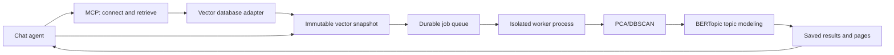

# Architecture

The MCP process owns caller-scoped database definitions and read-only adapter clients. `connect_database` validates access and encrypts connection settings; clients keep only a connection ID and selected collection. `retrieve_records` scans a full collection or performs bounded semantic retrieval, then registers an immutable caller-owned vector snapshot. External callers can also register records directly.

The adapter interface supports Qdrant, Pinecone, Milvus, Weaviate and pgvector, plus plugin entry points for other databases. Optional SDKs load on demand. Query text uses a SentenceTransformer model resolved from saved options or stored metadata; other embedding providers supply an external query vector. Query-model inference runs on CPU in the MCP process, separately from analysis workers. Full scans use stored vectors without generating embeddings. Network requests and retrieved rows/bytes/time are bounded; native database limits still apply.

`Service` validates plans before queueing. One `Supervisor` holds an exclusive filesystem lock on its data directory and starts up to `max_jobs` spawned processes. Each process materializes records once, runs operations in dependency order, and saves portable JSON results. PCA/DBSCAN and topic extraction execute in these job processes, inside the worker container when deployed with Compose. The SDK runs the same algorithms synchronously in the calling process.

The HTTP or stdio MCP process remains available during analysis. HTTP uploads stream into a principal-specific staging directory; registration validates and copies them into durable dataset artifacts. Application code handles polling and cleanup of staged uploads. Results expose record IDs, assignments, topic terms, examples, scope, effective parameters and provenance. DBSCAN pages also contain 3D coordinates; the caller builds the plot.

`metadata.sqlite` holds job state and artifact ownership. `connections.sqlite` holds encrypted database settings and public caller/connection metadata. Its Fernet key comes from the server environment and is not stored in SQLite. Files hold dataset, materialization and result content. Successful jobs and connections remain readable after restart with the same key. Interrupted jobs are marked failed; cancellation terminates the selected process. Changing worker count requires restart. Automatic retention is not implemented.

The package requires NumPy, SciPy, scikit-learn, Pydantic, threadpoolctl and cryptography. BERTopic is the topic modeling dependency and includes its own supporting libraries. MCP/Uvicorn and database SDKs are optional extras. Analysis uses supplied embeddings and DBSCAN assignments; it does not download or run an embedding model. Text-query retrieval may download and run a separate query model on first use.
