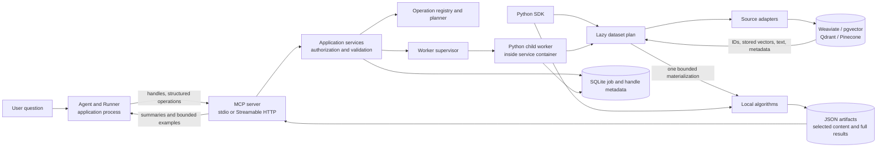
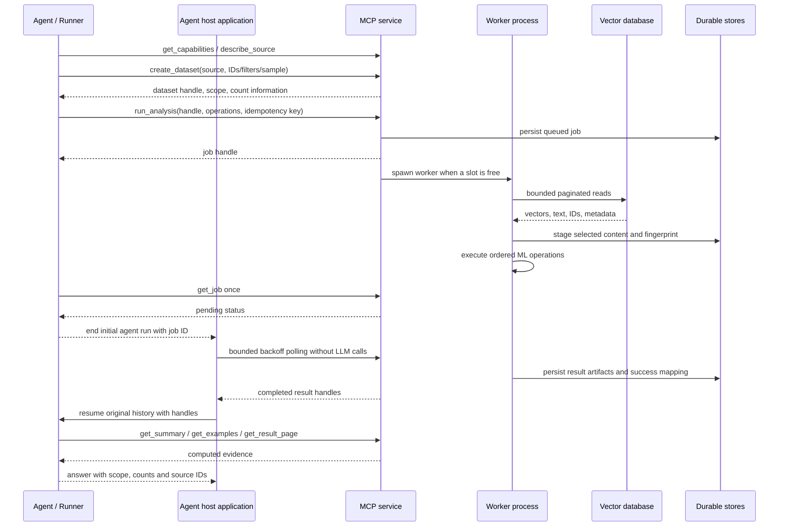

# Architecture

The SDK and MCP service use the same dataset, registry and operator implementations. Database clients retrieve records; algorithms never depend on a database client or the MCP transport. The local SDK computes in its calling process. The service starts a Python child process for each accepted worker slot, so ML does not block protocol discovery or status requests.

## Boundaries

- **Source adapters:** scoped identity, stored-vector retrieval, ID fetch, batch iteration and capability reporting. PostgreSQL pushes common filters into SQL; other adapters use the shared predicate evaluator over bounded reads.
- **Dataset layer:** immutable lazy selections, deterministic sampling, record alignment, row/byte limits, Arrow conversion and execution-time fingerprints.
- **Registry/planner:** typed operation specifications, unique IDs, supported parameters, dependencies, resource settings and backend validation. A whole plan uses one local backend. Temporal ops (`drift`, `novelty`, `flow`) declare `temporal: True` plus `frame_params`; the backend builds one shared `TemporalFrame` per bucketing so every temporal op in a plan sees identical bucket assignment.
- **Temporal frames:** `TemporalFrame` (`vector_tools/temporal.py`) is bucketing computed once per dataset: ISO day/week/month labels, small-bucket filtering, edge flags, and one embedding matrix. Content-addressed by dataset fingerprint with a bounded in-process cache. New temporal ops take `(data, frame, **params)` and only implement their math.
- **Evidence packs:** `render_evidence` (`vector_tools/evidence.py`, format `evidence/1.0`) renders op results into citation-keyed LLM context. Renderers assert non-degeneracy (novelty needs record text, flow needs positive shares) and raise `VTError` instead of emitting misleading packs. Workers persist an `evd` artifact for temporal jobs; `get_evidence` (SDK, service, MCP) renders single results on demand.
- **Public interfaces:** SDK methods and official-MCP-SDK tools call the shared implementations.
- **Execution:** transport-independent operators with JSON result contracts. `LocalBackend.execute` is synchronous; the service supervisor provides the asynchronous lifecycle around it.
- **Persistence:** SQLite WAL stores principal-scoped handles and jobs. JSON files store dataset plans, staged selected content and immutable full results. Atomic file replacement precedes metadata publication.
- **Public interfaces:** SDK methods and official-MCP-SDK tools call the shared implementations.

## Worker lifecycle and durability

One supervisor exclusively locks the configured data directory. It accepts at most `max_pending_jobs` jobs and runs at most `max_jobs` spawned children. Each child constructs its own service-owned clients, stages one materialization, executes the full plan, publishes result handles, and closes its connections. The metadata and artifacts directory must be mounted persistently in Docker.

States are `queued → running → succeeded|failed`, with cancellation possible before completion. Cancellation terminates and joins the process before publishing `cancelled`; if completion wins the race, success and result handles are retained. `max_seconds` includes worker startup and source reads; exceeding it terminates the worker and produces a failure.

A normal shutdown stops running workers and marks queued jobs failed. On restart, jobs left queued/running become `failed` with an interruption reason; they are not silently resumed. A watchdog exits an orphaned worker if its supervisor dies. Partial unreferenced artifacts can remain after interruption and need operator cleanup. Completed results survive disconnects and restarts. SQLite and artifacts belong to one service replica; this MVP is not a distributed queue.

## Authorization and network boundaries

HTTP bearer tokens are read from environment variables named in the service configuration and map to caller IDs. Each caller has an explicit source allowlist. Dataset, job, artifact and result handles are checked against their owner on every access. HTTP is stateless to avoid cross-principal session reuse. Stdio uses `VECTOR_ML_CALLER` (default `local`) and the OS process boundary.

Unauthenticated HTTP is permitted only when explicitly binding loopback and no tokens are configured. The Compose deployment binds the host port to loopback and uses a development token. Remote hosting needs operator-managed TLS, token management, firewall policy, and appropriate host/origin allowlists in `server.py`; this MVP implements static bearer authentication, not a full OAuth authorization server. Health is a non-sensitive unauthenticated route.

Credentials stay in configured service connections. Models receive no full embeddings or selected datasets through summaries or examples. SQL filters are parameterized; model inputs cannot choose arbitrary database endpoints, DSNs, filesystem paths, or Python code.

## Future Spark extension

`Backend` defines capabilities, validation, submission, status, cancellation and results. `Partition` describes disjoint Arrow artifacts with row counts and checksums. A Spark implementation must stage these onto storage readable by executors or implement source partition readers that assign each record to exactly one partition. Executors must not independently scan the full source. The driver handles manifests and result references, not full matrices.

| Capability | Local | Spark |
|---|---|---|
| MiniBatchKMeans | Implemented and tested | Unimplemented; Spark KMeans has different semantics |
| c-TF-IDF | Implemented and tested | Unimplemented distributed term aggregation |
| VADER | Implemented and tested | Unimplemented partition inference |
| IsolationForest | Implemented and tested | Unimplemented; requires an explicitly installed distributed algorithm |
| Bucket cosine drift | Implemented and tested | Unimplemented distributed centroid aggregation |
| Past-centroid novelty | Implemented and tested | Unimplemented distributed similarity scan |
| Cluster histogram flow | Implemented and tested | Unimplemented distributed term aggregation |
| Job lifecycle | Service supervisor and SQLite | Extension protocol only |
| Partition input | Arrow-compatible table export | Partition contract only |

Requests for Spark fail before execution and identify local as the available alternative. No sklearn estimator is relabelled as distributed. Additional sources, incremental model updates, advanced topic models and dashboards remain roadmap items.
