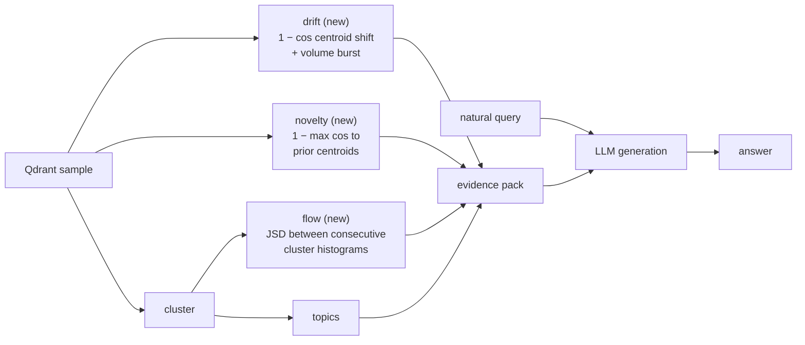

# Time-Series Experiment: What Was Built vs What Was Borrowed

> Engineered follow-up: the script glue below (`build_slice`, per-op bucketing) is superseded by
> `TemporalFrame` + `render_evidence()` in the library (`architecture.md`, `contracts.md`).
> This document remains the experiment record.

Experiment over Qdrant `mongodb_tech_news_native_256` (1.57M pts, 256-d, seeded 8k sample).
Pipeline code: `examples/rag_prompts_ops.py` → `examples/rag_prompts_ask.py`.
Evidence: `work/rag_prompts_evidence.json`. Answers: `work/rag_prompts_answers_v2.md`.

## 1. Fundamental time-series layer (new — the actual contribution)

Shared math in `vector_tools/temporal.py`:

| Primitive | Meaning |
|---|---|
| `parse_time` / `bucket_key` | timestamp → `month` / ISO `week` bucket labels |
| `centroid` / `l2_normalize` | L2-normalized bucket centroids (Dot == cosine) |
| `cosine_drift` / `cohesion` | `1 − cos(c_t, c_{t−1})`, mean cos to centroid |
| `jensen_shannon` | base-2 JSD between histograms |

Three first-class ops in `vector_tools/operators.py` (+ `registry.py`, `schemas.py`):

| Op | Algorithm | Answers |
|---|---|---|
| `drift` | `bucket_cosine_drift` | per bucket: cohesion, drift_prev, volume-z burst flag, edge flag |
| `novelty` | `past_centroid_novelty` | per record: `1 − max cos` to cumulative prior centroids + p50/p90 calibration |
| `flow` | `cluster_histogram_flow` | per bucket: cluster histogram, `jsd_vs_prev`, largest share |

Tests: `tests/test_temporal_ops.py` (11 deterministic, no services).

## 2. Attached pre-existing ops (borrowed, not built)

| Op | Role in the experiment |
|---|---|
| `cluster` (minibatch k-means) | partitions the space so `flow` has histograms and `topics` has groups |
| `topics` (c-TF-IDF) | human-readable terms per cluster — what the LLM actually names |
| `outliers` (isolation forest) / `sentiment` (VADER) | compatible, **not exercised** in this experiment |

## 3. Experiment-only glue (scripts, deliberately not library code)

- **Keyword-onset counts** (`rag_prompts_ops.py`): plain substring hits per ISO week for `agents_vector`, `layoffs_funding`, `opensource`, `earnings` — a cheap baseline the vector ops are judged against.
- **Evidence renderer** (`build_slice` in `rag_prompts_ask.py`): op `Result`s → 1–6KB per-query pack (bucket tables, novelty tops *with record text*, calibration, edge flags). Lesson learned: this renderer is the product candidate for promotion to `render_evidence()`.
- **Asker**: live `muse-spark-1.3-contributor` Responses streaming call, evidence-only system prompt, two style passes (v1 metric-dense → v2 natural prose).

## 4. Flow

## 5. Result (10 prompts, live model)

8/10 strong, 2 honest partials, zero hallucinations across all cited values.
Key finding: failures localized to evidence gaps (off-topic novelty tops, sparse keyword hits),
never to generation — and the model's abstentions ("I couldn't find…") were the most valuable outputs.
Two renderer bugs caught by this loop: missing record text in novelty tops, zeroed monthly shares.
